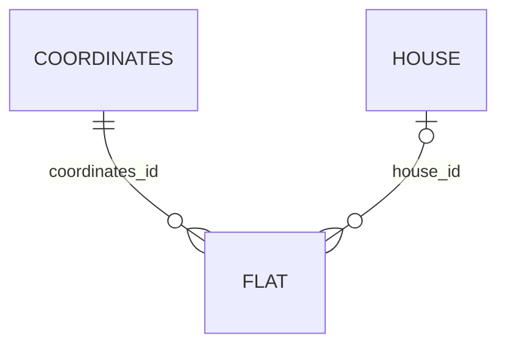

# Модель данных



- Каждая квартира ссылается на одни координаты. Дом для квартиры необязателен.
- Одни и те же `Coordinates` и `House` могут использоваться несколькими квартирами. Поэтому у вспомогательных таблиц есть внутренние ID, хотя они не показаны в формулировке классов.
- `ON DELETE RESTRICT` запрещает удалить координаты или дом, пока на них ссылается хотя бы одна квартира. Удаление самой квартиры не удаляет связанные объекты.
- ID создаются PostgreSQL через `GENERATED ALWAYS AS IDENTITY`. Дата создания заполняется автоматически в JPA и имеет серверное значение по умолчанию в БД.
- Ограничения полей есть и в Java-моделях, и в SQL-схеме. Проверка JPA включена в `persistence.xml`.

Схема находится в [schema.sql](init/schema.sql). При первом запуске с пустым Docker volume PostgreSQL выполняет её автоматически. Этот файл предназначен для создания новой схемы, повторно применять его к существующим таблицам не нужно.

Пользователи хранятся в отдельной таблице `app_user`: уникальный логин и хеш пароля с солью. Таблица создаётся скриптом [users.sql](init/users.sql), который Compose применяет после схемы и SQL-функций. Для существующей базы примените этот SQL-файл отдельно, как показано ниже. Квартиры не связаны с пользователями; все вошедшие пользователи имеют одинаковые права.

Пять функций из задания находятся в [flat_functions.sql](init/flat_functions.sql):

| Функция | Результат |
| --- | --- |
| `flat_max_area()` | Квартира с максимальной площадью |
| `flat_count_by_house(bigint)` | Количество квартир с указанным `house_id`; `NULL` считает квартиры без дома |
| `flat_names_starting_with(text)` | Квартиры с буквальным, регистрозависимым префиксом имени |
| `flat_most_expensive_without_balcony()` | Самая дорогая квартира с `balcony = false` |
| `flat_most_expensive_of_three(integer, integer, integer)` | Самая дорогая из трёх различных существующих квартир |

При равных площадях или ценах выбирается квартира с меньшим ID. Функции, возвращающие одну квартиру, возвращают пустой набор, если подходящих квартир нет. Проверку положительных, различных и существующих ID для последней операции выполняет `FlatOperationsService`.

На новой базе `schema.sql` применяется автоматически перед `flat_functions.sql`: Compose монтирует их в контейнер как `01_schema.sql` и `02_flat_functions.sql`, чтобы задать порядок запуска. Если Docker volume уже существует, выполните из корня проекта:

```powershell
Get-Content -Raw db/init/flat_functions.sql | docker compose exec -T db sh -c 'psql -v ON_ERROR_STOP=1 -U "$POSTGRES_USER" -d "$POSTGRES_DB"'
Get-Content -Raw db/init/users.sql | docker compose exec -T db sh -c 'psql -v ON_ERROR_STOP=1 -U "$POSTGRES_USER" -d "$POSTGRES_DB"'
```

Команды выполняются в PowerShell и применяют функции и таблицу пользователей через `psql` в работающем контейнере `db`. Используются настройки БД внутри контейнера, выполнение останавливается при ошибке. `CREATE OR REPLACE FUNCTION` позволяет повторное применение без удаления данных.

При развёртывании на кафедральном сервере примените этот файл через `psql -h pg -d studs -U <логин> -v ON_ERROR_STOP=1 -f db/init/flat_functions.sql`. Пароль вводится средствами клиента PostgreSQL. Если таблицы ещё не созданы, сначала примените `schema.sql`.
